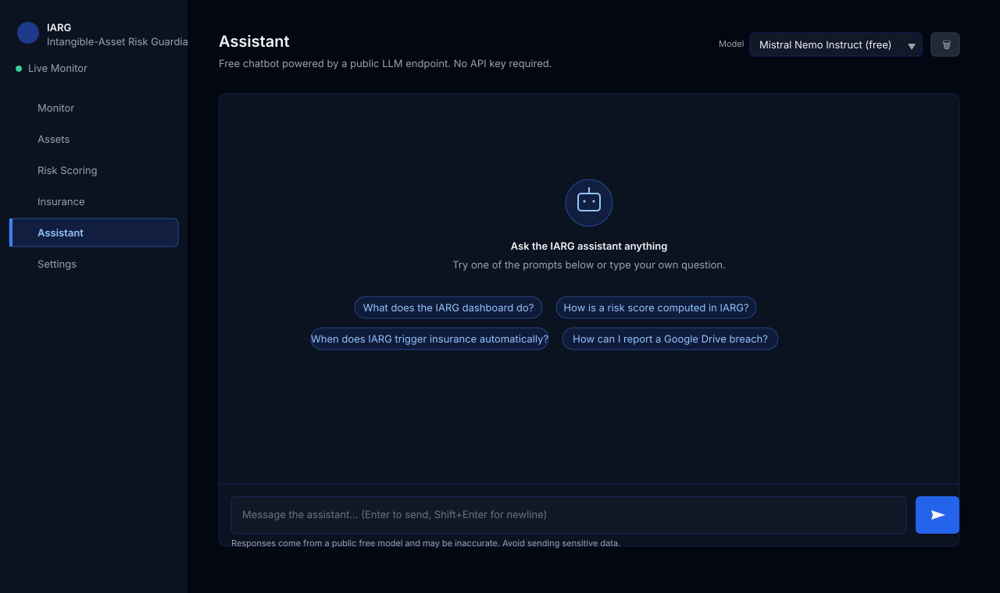
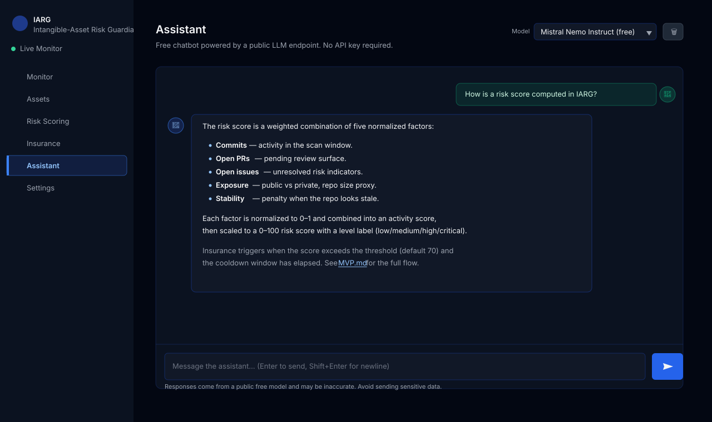
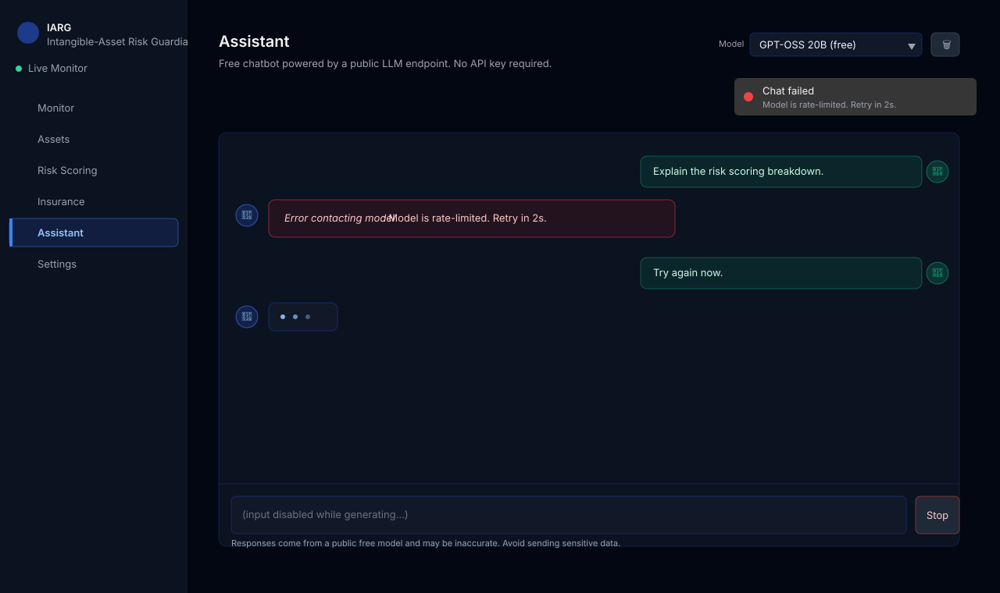
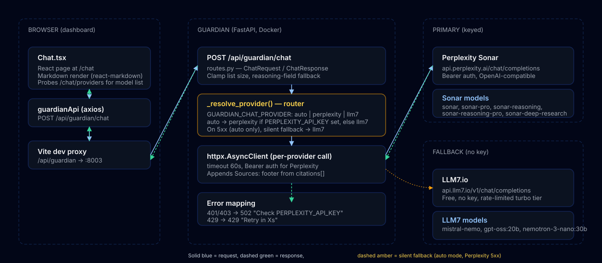

# IARG Assistant — UI Wireframes

These wireframes show the three primary states of the Assistant tab plus the
runtime architecture it rides on. Each is a standalone SVG under
[`./wireframes/`](./wireframes/).

Pixel dimensions mirror the live dashboard at a 1280×760 viewport; the real
UI is responsive and will flex.

---

## 1. Empty state (first visit)

What the user sees the first time they land on `/chat`. Full-width card,
greeting block, 4 suggested prompts as chips, idle input with Send.

Notes:
- Sidebar matches the rest of the app; "Assistant" is marked active with the
  left-blue bar and blue-tinted background.
- The chip prompts are clickable and short-circuit straight into `send()`.
- Input shows the keybinding hint inline: *Enter to send, Shift+Enter for newline.*

---

## 2. Active conversation (markdown reply)

Mid-conversation view after sending a question. User bubble on the right
(green), assistant bubble on the left (blue) with real markdown rendering:
bold terms, bullet list, a link.

Notes:
- Assistant bubble width caps at ~80% of the chat area; user bubble auto-sizes
  to its content.
- Links in replies open in a new tab (`target="_blank"`).
- Scroll area pins to the latest message after each append.

---

## 3. Error / rate-limited / in-flight

The upstream (LLM7) returned 429 for the first attempt, the user retried, and
a second request is now in flight. Shows all three failure-adjacent affordances
at once: the toast, the inline `_Error contacting model_` bubble, the typing
dots, and the **Stop** button replacing **Send** while loading.

Notes:
- Rate-limit toast matches the global `react-hot-toast` style used elsewhere.
- The inline error bubble styles with red stroke so it's distinct from a
  normal reply but still flows with the conversation.
- Hitting **Stop** aborts via `AbortController` and silently returns the UI to
  idle — no synthetic error bubble.

---

## 4. Runtime architecture

How a message travels from the browser to the active upstream model and back.
Solid blue = request, dashed green = response, dashed amber = silent fallback
to LLM7 when the primary (Perplexity) returns a transient 5xx in `auto` mode.

Key points:
- Browser never calls any LLM directly; the Guardian proxy is the only
  egress point. The `PERPLEXITY_API_KEY` never leaves the server.
- `GUARDIAN_CHAT_PROVIDER` controls the router: `auto` (default) picks
  Perplexity when the key is set and LLM7 otherwise. `perplexity` and `llm7`
  are explicit overrides.
- `GET /chat/providers` lets the frontend render the correct model picker
  without hard-coding which upstream is live.
- Model aliases are resolved server-side so a stale frontend never breaks
  the API.
- Perplexity `citations` are flattened into a `Sources:` footer before the
  reply is returned.
